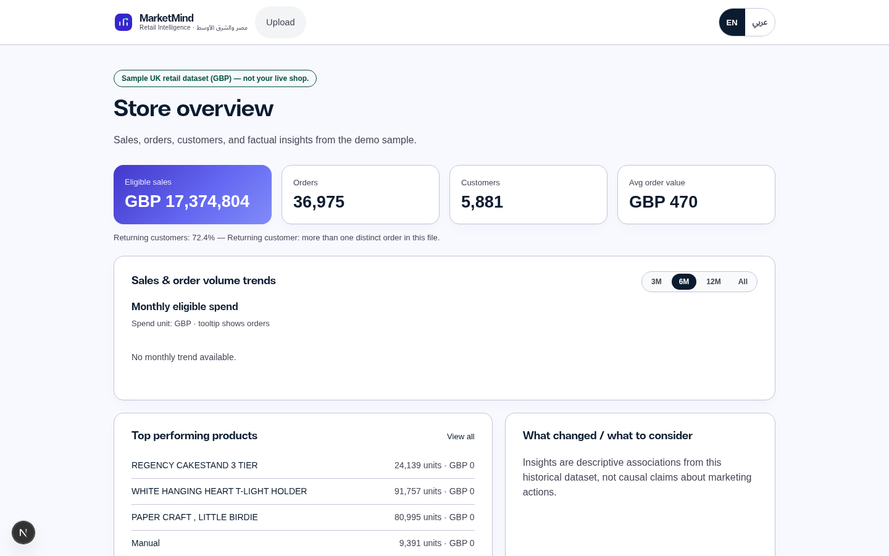

# MarketMind

Customer Lifetime Value and Segmentation Engine for SME online retailers (NextGen ML final project).

MarketMind groups customers with RFM + K-Means and estimates eligible spend in the next 90 days using a time-aware observation cutoff.

## Product UI (primary)

Local **Next.js** (`web/`) + **FastAPI** (`api/`). Arabic RTL / English LTR. Entry is a bilingual landing at `/` with CTA **يلا جرب** → `/upload`. Demo data is **UK Online Retail II in GBP**. Boundaries and upload privacy: `docs/frontend_backend_split.md`.

```bash
source .venv/bin/activate
uv pip install -r requirements.txt
# Optional browser smoke / Playwright journeys:
# uv pip install -r requirements-dev.txt && playwright install chromium
PYTHONPATH=src:. uvicorn api.main:app --reload --port 8000
# other terminal
cd web && npm install && npm run dev
```

Demo API after a clean clone uses committed `data/processed/customer_*.parquet`,
`transactions_demo_sample.parquet`, and `reports/demo_store_snapshot.json`.
The full `transactions_cleaned.parquet` is optional (gitignored; rebuild via the cleaning pipeline).

Open http://127.0.0.1:3000 (or `npm run dev -- -p 3001` if busy). Rewrites `/api/*` to the API.

The academic app required by the project PDF is Streamlit: `streamlit run app.py` from the repo root. The Next.js UI above is the local product interface and is **not** the Community Cloud entrypoint.

## Upload → analysis journey (product)

1. Upload CSV or Excel on `/upload`.
2. If the workbook has multiple sheets, pick the sales worksheet (not assumed silently).
3. Confirm column mapping when headers are unknown or ambiguous (e.g. bare `Amount` / `Total`).
4. Confirm currency when not present; confirm date format only when ambiguous.
5. Review cleaning proposals and unresolved gaps (no invented IDs/dates/quantities).
6. Open the **upload** store dashboard (`/store`) — never mixed with UK demo tables.

Session settings (mapping, sheet, currency, date format) live in the upload session and drive cleaning, analytics, exports, and the assistant.

### POS / retail export compatibility (tested)

**Not “any supermarket file.”** Proven against fixtures in `tests/fixtures/client_uploads/` (see that folder’s README + `matrix_manifest.json`):

| Fixture | Layout | Money | Notes |
|---------|--------|-------|-------|
| Egypt CSV/XLSX sample | UCI-like EN + Category | qty × price | Isolation / product journey; not academic evidence |
| `synth_pos_en_qty_price.csv` | `order_date`, `item`, `qty`, `unit_price` | qty × price → **69** | Browser EN + mobile |
| `synth_supermarket_line_total.csv` | `LineTotal`, no unit price | line amount → **81** | No double-count |
| `synth_arabic_headers.csv` | Arabic headers | qty × price | Alias path |
| `synth_no_customer_id.csv` | No customer / invoice | qty × price → **41** | Customer KPIs N/A; browser AR RTL + mobile |
| `synth_uci_no_category.csv` | UCI without Category | qty × price | Category charts off |
| `synth_ambiguous_amount.csv` | Ambiguous `Amount` | needs map → **67.5** | Never auto unit_price |
| `synth_iso_dates.csv` | ISO dates | qty × price | No forced dayfirst |
| `synth_semicolon_bom.csv` | `;` + UTF-8 BOM | qty × price | Encoding/delimiter |
| `synth_multisheet_sales.xlsx` | sheets Summary / SalesLines | qty × price → **170** | Must select SalesLines |

Synthetic fixtures test **behavior only** — not model quality.

**Manual mapping still required** for unrecognized headers and ambiguous Amount/Total. Missing customer ID, date, invoice, or category disables only dependent metrics (explained in UI). Multiple currencies are never summed or FX-converted; pick one analysis currency. Rows with a blank or unknown currency stay out of that total, and the screen shows how many were excluded and why.

## Public product (Next.js + FastAPI)

**Live product UI:** https://marketmind-web-ochre.vercel.app/  
**API:** https://marketmind-api-phi.vercel.app/ (`GET /api/meta`)

This is the real upload → mapping → cleaning → store analytics product (`web/` + `api/`).

## Streamlit Community Cloud (academic PDF only)

**Live (course PDF shell):** https://marketmind-grad.streamlit.app/

Streamlit serves the academic multipage app (`app_pages/*`) required by the project PDF (segments, CLV, model quality). It is **not** the Next.js product UI. Optional Stitch HTML (`?stitch=1`) is a static export only.

Deployed from `joeali12/MarketMind` · `main` · `app.py` · Python 3.12 · no secrets. Anonymous access works (`viewerAuthEnabled=false`). LinkedIn/CV drafts stay unpublished.

The Cloud app reads committed artifacts and the small derived parquet files in `docs/deployment.md`. It does not need `data/raw/online_retail_II.xlsx`.

## Screenshots (current product UI)

Local **Next.js + FastAPI** product (not the academic Streamlit multipage shell). Captured 2026-11-14 from `http://127.0.0.1:3001`.

**Upload (entry / home redirects here)**


**Store overview (demo UK sample)**



Also: `docs/screenshots/upload.png` (same upload surface), `docs/screenshots/products.png`, and browser journey shots under `docs/screenshots/e2e/`.

## Data source

Chen, D. (2012). Online Retail II [Dataset]. UCI Machine Learning Repository. https://doi.org/10.24432/C5CG6D  
UCI page: https://archive.ics.uci.edu/dataset/502/online+retail+ii

Raw data is **not** committed. Download locally:

```bash
source .venv/bin/activate
python scripts/download_online_retail_ii.py
```

Confirmed workbook: two sheets totaling **1,067,371** rows. See `docs/data_dictionary.md` and `docs/cleaning_policy.md`.

## Setup

```bash
cd MarketMind
uv venv .venv --python 3.12
source .venv/bin/activate
uv pip install -r requirements.txt
export PYTHONPATH=src
```

## Assistant (Gemini 2.5 Flash)

Optional explanations use Google’s `google-genai` SDK with **Gemini 2.5 Flash**. Classical ML artifacts remain the source of truth. **Raw user questions are never sent** — only fixed safe templates plus allowlisted aggregates / tool results (no raw row dumps).

1. Create a key in [Google AI Studio](https://aistudio.google.com/apikey).
2. Copy `.env.example` → `.env` and set `GEMINI_API_KEY` (never commit it).
3. Restart `uvicorn`. Successful answers are labeled **Gemini response**; otherwise the UI shows **Grounded facts (fallback)**.

Details: [`docs/assistant_gemini.md`](docs/assistant_gemini.md). Academic ML audit: [`docs/ML_ACADEMIC_AUDIT.md`](docs/ML_ACADEMIC_AUDIT.md).

```bash
# Automated tests — no API key required
pytest -q tests/test_gemini_provider.py tests/test_assistant_context.py tests/test_assistant_status.py

# Opt-in live smoke (only with a local key)
python scripts/smoke_gemini.py
```

## Pipeline (academic artifacts)

```bash
python scripts/download_online_retail_ii.py

# Clean (or use notebook)
python - <<'PY'
from marketmind.data import load_online_retail_ii, clean_transactions
df = load_online_retail_ii()
cleaned = clean_transactions(df)
cleaned.data.to_parquet('data/processed/transactions_cleaned.parquet', index=False)
cleaned.reconciliation_frame().to_csv('reports/cleaning_reconciliation.csv', index=False)
print(len(cleaned.data))
PY

python scripts/run_eda.py
python scripts/train_marketmind.py
pytest -q
# Product UI: uvicorn api.main:app + cd web && npm run dev
# Academic UI (PDF / Community Cloud entrypoint): streamlit run app.py
```

The app **loads saved artifacts only** and never silently retrains.

## Results (held-out chronological test)

Source: `artifacts/model_metadata.json`. Academic UCI demo only — not upload-store forecasts.

| Model | MAE | RMSE | R² | Split |
|---|---:|---:|---:|---|
| Mean baseline | 609.26 | 3290.69 | -0.006 | Test cutoff 2011-09-10; 90-day target |
| Gradient boosting (selected) | 452.10 | 2650.95 | 0.347 | Same |

Units: **eligible positive spend** over 90 days in **GBP (£)** (UCI dataset description; no FX conversion). Target excludes cancellation invoices matching the conservative `C####` / `C-…` rule and non-positive quantities — not net revenue after refunds (D5). Selection used training CV MAE only; test evaluated once. **R² is not an accuracy percentage.**

**Cutoffs:** train 2010-12-11 · test 2011-09-10 · lookback = full history on/before cutoff.  
**Scale:** source 1,067,371 rows → cleaned 797,885 · train customers 4,316 · test 5,283.  
**Segments:** K-Means **k=2** (train silhouette 0.425 vs k=3 at 0.329). Labels from profiles: *Recent high-spend* / *Lapsed low-spend*. Hierarchical ward silhouette ≈ 0.418 at k=2. k=3 retained as sensitivity only (`reports/k_sensitivity.json`).

## App pages (product)

- Next.js routes: Home, Upload, Store, Products, Groups, Profile, Project
- Demo mode uses precomputed UK customer tables (GBP)
- Upload mode uses the active session only
- Marketing actions are **provisional heuristics** only (`actions_approved=false`) — not approved policy (D7)

## Limitations

- Historical UK giftware data (2009–2011) for the academic demo model
- Upload analytics are descriptive / capability-aware; store-specific 90-day forecast needs enough history
- High zero-target rates in the academic 90-day window
- Target is eligible positive spend (D5), not net revenue after refunds
- Currency GBP (£) for demo from UCI description; uploads never assume EGP/GBP/USD from filename
- Not a commercial multi-tenant SaaS; product UI on Vercel + API; Streamlit Cloud is PDF-only at https://marketmind-grad.streamlit.app/ (D8 Streamlit approved; LinkedIn still unpublished)

## Docs

- `docs/frontend_backend_split.md` — product API + privacy boundaries  
- `docs/model_card.md` — model card  
- `docs/open_decisions_register.md` — TBD register  
- `docs/presentation_outline.md` — slide outline (unpublished)  
- `docs/linkedin_cv_draft.md` — drafts (do not post without approval)  
- `docs/deployment.md` — deploy prep without publishing  

## License

Dataset terms follow UCI. Project code is MIT — see `LICENSE`.
