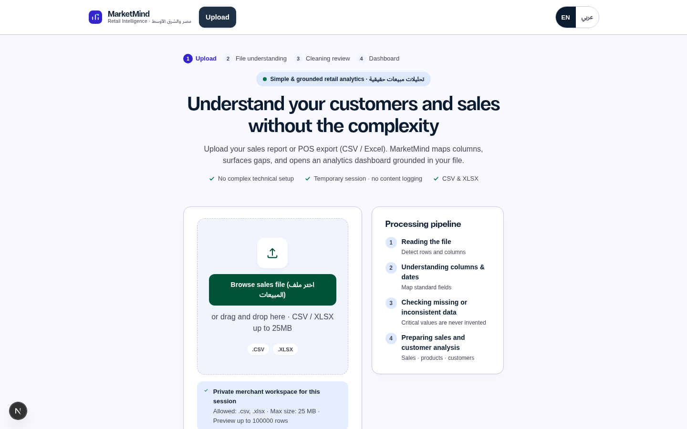

# MarketMind

Customer Lifetime Value and Segmentation Engine for SME online retailers (NextGen ML final project).

MarketMind groups customers with RFM + K-Means and estimates eligible spend in the next 90 days using a time-aware observation cutoff.

## Product UI (primary)

Local **Next.js + FastAPI** (top navigation, no sidebar). Demo data is **UK Online Retail II in GBP**. Boundaries and upload privacy: `docs/frontend_backend_split.md`.

```bash
source .venv/bin/activate
uv pip install -r requirements.txt
PYTHONPATH=src:. uvicorn api.main:app --reload --port 8000
# other terminal
cd web && npm install && npm run dev
```

Open http://127.0.0.1:3000 (or `npm run dev -- -p 3001` if busy).

The PDF app is Streamlit: `streamlit run app.py` from the repo root. That file is the Community Cloud entrypoint.

## Streamlit Community Cloud (PDF app)

**Approved, not live.** Public deploy of the Streamlit app was approved on 2026-11-11 (D8). No `streamlit.app` URL exists yet.

1. Repository: `https://github.com/joeali12/MarketMind`
2. Branch: `main`
3. Main file path: `app.py`
4. Python 3.12 (`runtime.txt`). Leave secrets empty. Do not add `.env`.

See `docs/deployment.md`. Record a URL here only after that URL opens and its pages are checked.

## Screenshot



_Captured from the local Streamlit demo. Replace/update after UI changes._

## Data source

Chen, D. (2012). Online Retail II [Dataset]. UCI Machine Learning Repository. https://doi.org/10.24432/C5CG6D
UCI page: https://archive.ics.uci.edu/dataset/502/online+retail+ii

Raw data is **not** committed. Download locally:

```bash
source .venv/bin/activate
python scripts/download_online_retail_ii.py
```

Confirmed workbook: two sheets totaling **1,067,371** rows. See `docs/data_dictionary.md` and `docs/cleaning_policy.md`.

## Setup

```bash
cd MarketMind
uv venv .venv --python 3.12
source .venv/bin/activate
uv pip install -r requirements.txt
export PYTHONPATH=src
```

## Assistant (Gemini 2.5 Flash)

Optional explanations use Google’s `google-genai` SDK with **Gemini 2.5 Flash**. Classical ML artifacts remain the source of truth. **Raw user questions are never sent** — only fixed safe templates plus allowlisted aggregates.

1. Create a key in [Google AI Studio](https://aistudio.google.com/apikey).
2. Copy `.env.example` → `.env` and set `GEMINI_API_KEY` (never commit it).
3. Restart `uvicorn`. Successful answers are labeled **Gemini response**; otherwise the UI shows **Grounded facts (fallback)**.

Details: [`docs/assistant_gemini.md`](docs/assistant_gemini.md). Academic ML audit: [`docs/ML_ACADEMIC_AUDIT.md`](docs/ML_ACADEMIC_AUDIT.md).

```bash
# Automated tests — no API key required
pytest -q tests/test_gemini_provider.py tests/test_assistant_context.py tests/test_assistant_status.py

# Opt-in live smoke (only with a local key)
python scripts/smoke_gemini.py
```

## Pipeline

```bash
python scripts/download_online_retail_ii.py

# Clean (or use notebook)
python - <<'PY'
from marketmind.data import load_online_retail_ii, clean_transactions
df = load_online_retail_ii()
cleaned = clean_transactions(df)
cleaned.data.to_parquet('data/processed/transactions_cleaned.parquet', index=False)
cleaned.reconciliation_frame().to_csv('reports/cleaning_reconciliation.csv', index=False)
print(len(cleaned.data))
PY

python scripts/run_eda.py
python scripts/train_marketmind.py
pytest -q
# Product UI: uvicorn api.main:app + cd web && npm run dev
# Legacy: streamlit run app.py
```

The app **loads saved artifacts only** and never silently retrains.

## Results (held-out chronological test)

Source: `artifacts/model_metadata.json`.

| Model | MAE | RMSE | R² | Split |
|---|---:|---:|---:|---|
| Mean baseline | 609.26 | 3290.69 | -0.006 | Test cutoff 2011-09-10; 90-day target |
| Gradient boosting (selected) | 452.10 | 2650.95 | 0.347 | Same |

Units: **eligible positive spend** over 90 days in **GBP (£)** (UCI dataset description; no FX conversion). Target excludes cancellation invoices starting with `C` and non-positive quantities — not net revenue after refunds (D5). Selection used training CV MAE only; test evaluated once. **R² is not an accuracy percentage.**

**Cutoffs:** train 2010-12-11 · test 2011-09-10 · lookback = full history on/before cutoff.
**Scale:** source 1,067,371 rows → cleaned 797,885 · train customers 4,316 · test 5,283.
**Segments:** K-Means **k=2** (train silhouette 0.425 vs k=3 at 0.329). Labels from profiles: *Recent high-spend* / *Lapsed low-spend*. Hierarchical ward silhouette ≈ 0.418 at k=2. k=3 retained as sensitivity only (`reports/k_sensitivity.json`).

## App

- Framework: Streamlit (`app.py` + `app_pages/`)
- Demo mode: Home → “Open demo customer lookup” uses precomputed customer tables
- Marketing actions are **provisional heuristics** only (`actions_approved=false`) — not approved policy (D7)

## Limitations

- Historical UK giftware data (2009–2011)
- High zero-target rates in the 90-day window
- Target is eligible positive spend (D5), not net revenue after refunds
- Currency GBP (£) from UCI description; no FX conversion (D6)
- Not a commercial multi-tenant SaaS. Streamlit Community Cloud is approved and not live yet (D8)

## Docs

- `docs/model_card.md` — model card
- `docs/open_decisions_register.md` — TBD register
- `docs/presentation_outline.md` — slide outline (unpublished)
- `docs/linkedin_cv_draft.md` — drafts (do not post without approval)
- `docs/deployment.md` — Cloud / HF Spaces prep without publishing

## License

Dataset terms follow UCI. Project code license TBD until confirmed by the author.
